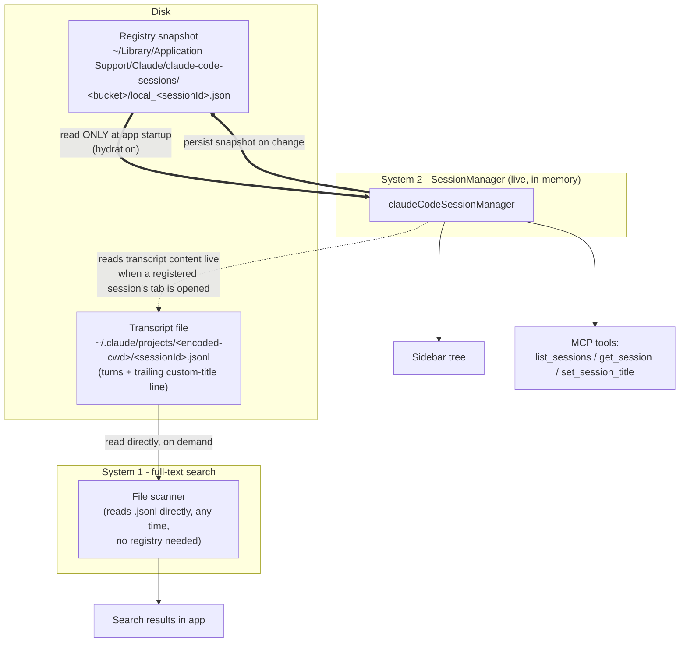

# Claude Desktop Internals

Reverse-engineered, undocumented internals of how the Claude Desktop app (the
Electron "Code" tab / `claude-code` CLI it manages) stores, discovers, and
displays sessions on disk. Needed whenever you have to **synthesize, restore,
or repair a session's transcript or its position in the app** — e.g.
importing chat history from another tool, fixing a mis-titled session, or
cleaning up ghost sidebar entries.

**Verified against:** Claude Desktop app `1.24012.9`, `claude-code` CLI
`2.1.217`–`2.1.219` (macOS), as of 2026-07-28.

> ⚠️ **None of this is documented or supported.** It was derived by reading
> the app's own bundled source (see "How to re-verify" below) and by
> controlled experiments. It **will drift across app versions** — re-verify
> before trusting any of it on a new version rather than assuming it still
> holds.

## Architecture: two independent systems

A session's `.jsonl` transcript file is visible to **search** the moment it
exists on disk. It is invisible to the **sidebar tree** and the MCP session
tools (`list_sessions`, `get_session`, `set_session_title`) until a separate
registry entry exists *and* the app has hydrated it into memory. Conflating
these two systems is the single biggest source of wrong conclusions when
debugging this stuff.



**Consequence:** writing a `.jsonl` file alone gets you search-hits, not a
sidebar entry. You need the registry file too, and the app has to reload it
from disk (full quit + relaunch) — the running app's in-memory `SessionManager`
is the sole source of truth while it's alive; it does **not** re-read the
registry file mid-run. Editing that file while the app has the session loaded
does nothing, and can be silently clobbered the next time the app persists
its own state for that session.

**Exception — there's a second, faster registration path.** The
`claude://resume?session=<uuid>` URL scheme (see
`~/.claude/skills/create-new-session-in-claude-desktop/`) registers a session into the
live `SessionManager` immediately, no quit+relaunch needed — Desktop's own
deep-link handler does the import in-process. This is *not* the same as the
raw-registry-file-write path above (which genuinely does need a restart); the
"only read at startup" rule applies to that path specifically, not to the app
importing a session via its own URL handler. Confirmed by direct test:
`get_session` returned "not found" for a brand-new session immediately after
its first turn finished, then returned a full record right after
`open "claude://resume?session=<uuid>"` — same app instance, no restart in
between. Side effect: this path stamps `createdAt`/`lastActivityAt` to *now*,
unlike the registry-file path which can preserve real historical timestamps.
**Two more confirmed side effects (2026-08-20):** the deep-link import also
clobbers the session's **custom title** (reverts to a generic placeholder,
same failure mode as the `--resume -p "noop"` touch above) and resets
**`permissionMode`** back to a default (`acceptEdits`), even if the session
was set to `bypassPermissions` before the link was opened. Both are
manually recoverable after the fact (re-title, re-select Bypass Permissions)
but not prevented — treat this deep-link path as "re-registers the session
from scratch," not a no-op resume.

## The two files a synthesized/restored session needs

### 1. Transcript

`~/.claude/projects/<encode_cwd(cwd)>/<sessionId>.jsonl`

- `encode_cwd(cwd)`: replace `/`, `.`, and `_` with `-` (e.g.
  `/Users/x/workspace/eng_ai_assistant` → `-Users-x-workspace-eng-ai-assistant`).
- JSONL, one entry per line: `user`/`assistant` turns, then a **trailing**
  line `{"type":"custom-title","customTitle":"...","sessionId":"..."}`.
  (Position doesn't actually matter — confirmed the app reads whichever
  `custom-title` line is last in the file — but appending it after the
  conversation is the simplest mental model.)
- Message `content` matches the Claude API shape: a plain string, or an array
  of blocks — `{"type":"text","text":"..."}`,
  `{"type":"image","source":{"type":"base64","media_type":"image/png","data":"<base64>"}}`.
  Multiple blocks (image + text) are fine in one user turn.
- Full field-by-field schema and a working synthesizer:
  `scripts/import_cursor_sessions.py`.

### 2. Registry entry

`~/Library/Application Support/Claude/claude-code-sessions/<bucket>/local_<sessionId>.json`

- `<bucket>` is a single directory two levels under `claude-code-sessions/`
  (glob for it — `claude-code-sessions/*/*` — don't hardcode the UUIDs).
- Minimal known-good shape (fields below are sufficient; the app has many
  more optional fields for live sessions — worktrees, PR links, etc. — that
  aren't needed for a synthesized one):

  ```json
  {
    "sessionId": "local_<sessionId>",
    "cliSessionId": "<sessionId>",
    "cwd": "<absolute project path>",
    "originCwd": "<same as cwd>",
    "lastFocusedAt": <epoch ms>,
    "createdAt": <epoch ms>,
    "lastActivityAt": <epoch ms>,
    "isArchived": false,
    "title": "<display title>",
    "titleSource": "auto",
    "permissionMode": "default",
    "remoteMcpServersConfig": [],
    "alwaysAllowedReasons": [],
    "sessionPermissionUpdates": []
  }
  ```

- **`createdAt`/`lastActivityAt` must come from the transcript's own message
  timestamps, not "now".** This is what keeps sidebar/API sort order correct
  — `list_sessions` sorts by `lastActivityAt`. Get this wrong and every
  restored session jumps to the top of the recency list.
- `isArchived: true` is the entire mechanism behind archiving — no companion
  timestamp field is required (confirmed against a real user-archived
  session's persisted shape).

## The validated recipe (zero-cost, no live process)

1. Write the transcript.
2. Write the registry entry, with real historical `createdAt`/`lastActivityAt`
   derived from the transcript's own timestamps.
3. Batch as many sessions as you're doing, **then** do **one** full quit +
   relaunch of the app (not one restart per session — hydration happens once,
   at startup, for everything on disk).

No `claude --resume`, no `-p`, no `--bg`, no model call needed anywhere in
this. Confirmed to correctly preserve: text content, images, title, and real
historical ordering — see `scripts/import_cursor_sessions.py` for the working
implementation (originally built to import Cursor IDE chat history, but the
transcript/registry mechanics are Cursor-agnostic).

## Dead ends that looked necessary but weren't

These cost the most time to disprove — read this before re-deriving them:

- **A `claude --resume ... -p "noop"` "registration touch."** Not needed, and
  actively harmful: it stamps `createdAt`/`lastActivityAt` to *now* (breaking
  sort order) and leaves a stray, wrongly-named live `interactive` process
  that the Desktop app keeps re-attaching to that project on every future
  launch, masking the real title with a generic placeholder
  (`"<project>-NN"`).
- **Calling `set_session_title` on a session with no registry entry yet.**
  Fails with "not found" — it can only rename a session the app already
  knows about. It is not a way to *create* a registration; write the full
  registry file first.
- **Patching the registry file for a session that's currently open/focused
  in the app.** The app periodically re-persists its own in-memory state for
  the active tab, silently overwriting the patch. Only works for sessions
  not currently loaded, and even then only takes effect after a restart.
- **Custom-title line position (start of file vs. end).** Doesn't matter.
  Not the mechanism that was actually failing in the cases where this was
  suspected — that was the missing/wrong registry entry.

## "Group by Folder" sidebar view: underscore/dot in folder name → "Other"

**Confirmed 2026-08-20.** A session whose project directory name contains an
underscore or dot (e.g. `eng_ai_assistant`, `underscore_test`) gets dumped
into the "Other" bucket in the sidebar's **Group by Folder** view instead of
its own folder header — but only while the session has **no registry entry
yet** (see architecture section above; a brand-new `claude -n "..."` probe
process, discovered by disk-scan/search rather than through the registry, is
the reproducing case). Confirmed reproducible on demand: `mkdir
underscore_test && cd underscore_test && claude -n "hello from
underscore_test"` lands in "Other"; the same probe run from a
no-underscore/no-dot directory name groups correctly.

Root cause (best-supported hypothesis, not confirmed from renderer source —
see caveat below): `encode_cwd()` collapses `/`, `.`, **and** `_` to the same
`-` character when naming the transcript directory
(`~/.claude/projects/<encoded>`). For a registry-less/orphan session, Desktop
has to reverse-derive project identity from that encoded directory name
alone, and the collapse is lossy — a path segment with an internal `_` or `.`
(e.g. `eng_ai_assistant`) is indistinguishable from extra path separators, so
matching it back to a known project fails and it falls back to "Other". A
project name with no internal `_`/`.` (e.g. `dealia`) has no such ambiguity
and groups correctly even without a registry entry.

**Caveat:** this could not be verified against the actual renderer logic —
the sidebar's grouping code is loaded live from claude.ai as web content, not
shipped in `app.asar`, so the `strings`-on-asar re-verify recipe below
doesn't reach it. DevTools on the running app would be the way to confirm the
exact mechanism if it matters later. Treat the underscore/dot correlation as
solid (directly reproduced twice); treat the "lossy encode_cwd reverse-lookup"
explanation as a hypothesis.

**Practical impact:** cosmetic only, and only hits sessions before they get a
registry entry (i.e. throwaway `-n` probes, not real day-to-day sessions,
which all group fine once registered — confirmed against dozens of existing
eng_ai_assistant entries). Not worth working around.

## Ghost / orphaned sidebar entries

The (formerly 30-day, see `docs/settings.md`-equivalent) `cleanupPeriodDays`
retention setting deletes a session's `.jsonl` transcript but does **not**
clean up its matching registry entry — leaving a real, titled sidebar row
that opens to empty/broken content. Detect via: registry entry exists, but
`~/.claude/projects/<encode_cwd(cwd)>/<cliSessionId>.jsonl` does not.
`scripts/cleanup_orphaned_sessions.py` finds and removes (or archives) these.
As of 2026-07-28, 899 such orphans existed in this environment, all dating
back to an earlier bulk import whose transcripts had aged out under the old
30-day setting (now raised to 3650 days — see
`docs/cross-skill-learnings.md`).

## How to re-verify on a new app version

The mechanisms above were found by reading the bundled app source — it's
minified but not obfuscated JavaScript, not a compiled binary — **do this
before extensive black-box trial-and-error**, not after:

```bash
strings -a "/Applications/Claude.app/Contents/Resources/app.asar" > /tmp/claude_asar_strings.txt
python3 -c "
data = open('/tmp/claude_asar_strings.txt', encoding='utf-8', errors='ignore').read()
idx = data.find('SEARCH_TERM')
print(data[max(0, idx-500):idx+1500])
"
```

Useful search terms and what they lead to:

| Term | Leads to |
|---|---|
| `custom-title` | the `Jee`/`rC` functions that append a title line to a transcript (what `set_session_title` calls under the hood) |
| `titleSource` | the `Ni()` serializer — the full field list a live session object persists to its registry file |
| `claude-code-sessions` | the `mwt`/`CCD_SESSIONS_BASE_DIR` constant and its usages |
| `sessionPermissionUpdates` | same serializer, useful as a second anchor since `Ni` reuses generic minified names per bundle chunk |

This answers in minutes what took many hours of live experimentation to
partially reverse-engineer empirically in the session that produced this doc.
See `docs/coding-standards.md` → "read the source before declaring something
impossible" — this is the concrete instance that motivated that rule.

## Open questions / unresolved

- One early test session (from a since-compacted portion of the originating
  conversation) appeared correctly titled and dated after nothing more than
  a transcript write + restart — no explicit registry file, no `--resume`
  touch. This was never reproduced despite three follow-up attempts under
  what looked like identical conditions. Best guess: some registration step
  happened earlier in that conversation that didn't survive the
  context-compaction summary, not a genuinely different code path. Treat the
  "registry entry required" finding above as the reliable one; don't assume
  transcript-only writes will work.
